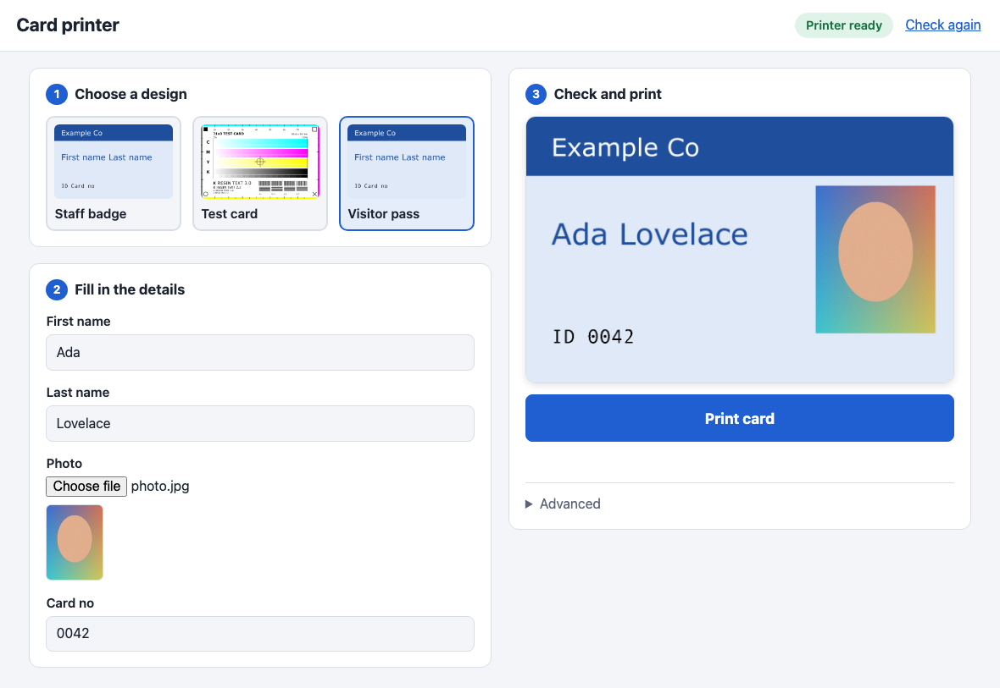
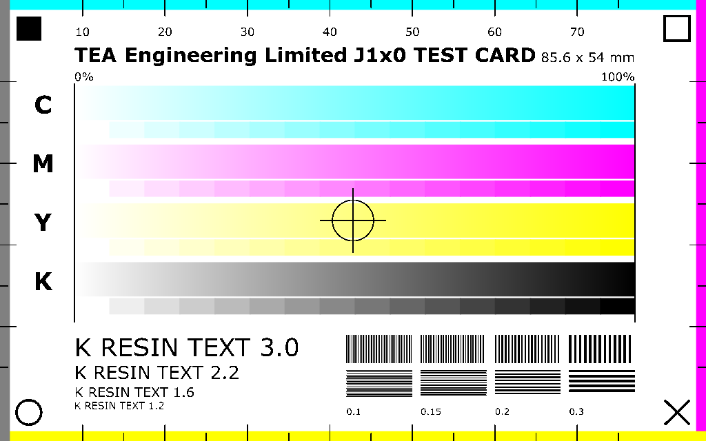
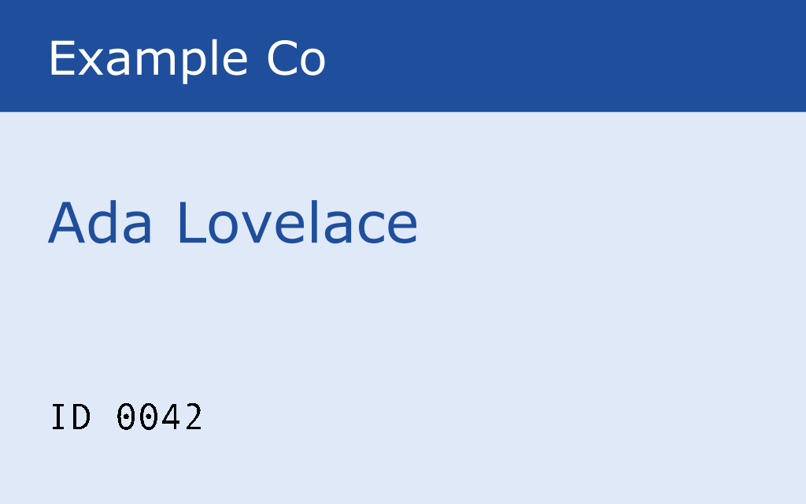

j1x0-cardprinter
================

Design a card in Inkscape, put `$tokens$` in it, and print it on a J1x0-series
(J100i / J110i / J120i) card printer over raw USB. No Windows driver required.

  [](https://badge.fury.io/py/j1x0-cardprinter)

> **Status: alpha. It prints cards on a J110i (firmware V1.18.25, YMCKO ribbon), from the command line and
> from the web UI.** The print protocol was reverse engineered from the vendor's Windows driver and
> checked against a USB capture of that driver printing ([docs/captured-job.md](docs/captured-job.md)):
> the job this tool builds is byte-for-byte what Windows sent. A printed test card matches its Inkscape
> preview, and a real card with a photo has been printed from the web UI.
> Not yet tried: other models in the family, other ribbons, duplex, the magnetic stripe and
> smart-card encoders (see [docs/open-questions.md](docs/open-questions.md)).

How it works
------------

```
card.svg + values  ->  render (Inkscape)  ->  Y/M/C planes + K bitmap  ->  USB
```

1. `$tokens$` in the SVG are replaced with your values.
2. The card is rendered at the printer's native 1024 x 640 grid, in two passes: colour artwork
   (printed with the yellow / magenta / cyan ribbon panels) and the layer named `K`
   (printed with the black resin panel).
3. The images are encoded and wrapped in the printer's command language, then written to the
   printer's USB bulk endpoint with libusb.

Install
-------

    $ pip install j1x0-cardprinter

You also need [Inkscape](https://inkscape.org) (the `inkscape` command on your `PATH`) to draw
the cards. It is the editor the designs are made in, and it renders them faithfully; see
[docs/rendering.md](docs/rendering.md) for why it is the default and not the faster
[CairoSVG](https://cairosvg.org), which silently drops filters, masks, wrapped text and more.
CairoSVG is available with `--renderer cairosvg` if you install it:

    $ pip install "j1x0-cardprinter[svg]"

On macOS and Linux `pyusb` needs the libusb library (`brew install libusb`, or your
distribution's `libusb-1.0` package).

Web UI
------

    $ j1x0



With no arguments `j1x0` starts a small web page on your own computer and opens it in your
browser. It is meant for someone who just needs to print cards:

1. **Choose a design.** Every `.svg` file in `~/.j1x0/` is offered, with a thumbnail. Save your
   Inkscape designs there (or set `J1X0_TEMPLATES`, or start with `j1x0 ui --templates DIR`).
2. **Fill in the details.** One box per `$field$` in the design, named from the field
   (`firstName` becomes "First name"). A field used as an image link (`xlink:href="$photo$"`)
   becomes a file picker; phone photos are rotated and shrunk automatically.
3. **Check and print.** The card is redrawn as you type, so the preview is always what will be
   printed. The status badge at the top shows whether the printer is found and ready, and the
   **Print card** button is only enabled when it is. The card sent to the printer is exactly the
   one in the preview.

The **Advanced** section has a way to print even when the printer reports a problem, and a button
that shows the full printer details. With no printer connected you can still choose, fill in and
preview cards.

`j1x0 ui` takes `--port` (default 8730), `--no-browser`, `--templates DIR`, `--vid/--pid` and
`--renderer`. The page is only reachable from this computer. `--host 0.0.0.0` makes it reachable
from others (for example a Raspberry Pi next to the printer), but it then has no login, so
anyone on the network can print.

A design is one Inkscape file with two kinds of layers: the colour artwork, and a layer named `K`
for black resin (text and barcodes). Objects outside every layer count as colour artwork.
[`examples/`](examples/) has two to start from.

Command line
------------

    $ j1x0 fields examples/card.svg
    fields: firstName, lastName, cardNo
    layers: Design, K

    $ j1x0 preview examples/card.svg -s firstName=Ada -s lastName=Lovelace -s cardNo=0042 -o out/
    $ j1x0 render  examples/card.svg -s firstName=Ada -s lastName=Lovelace -s cardNo=0042 -o job.bin
    $ j1x0 send                                          # check the printer, then stop
    $ j1x0 send    job.bin                               # check the printer, then send
    $ j1x0 print   examples/card.svg -s firstName=Ada -s lastName=Lovelace -s cardNo=0042

| Command | Needs | What it does |
|---|---|---|
| `ui` | Inkscape | The web UI above. Plain `j1x0` does this. |
| `fields` | | List the `$token$` fields and layer names in a template. |
| `preview` | Inkscape | Write `colour.png` and `k.png` so you can check the two renders. |
| `render` | Inkscape | Render a card to a printer job file. No printer needed. (`build` is an alias.) |
| `send` | printer | Check the printer. With a job file, then send it; without one, stop there. No Inkscape needed. |
| `print` | both | `render` then `send`, through a temporary job file. `-o job.bin` keeps the file. |

`render` and `send` can run on different machines: render where your design tools and fonts
are, send from the computer the printer is plugged into. Rendering is dithered randomly, so
add `--seed N` if you want repeated renders to be byte-identical.

Every field in the template needs a `-s NAME=VALUE`; the command stops and lists any that are
missing.

### Seeing what is sent (`-v`)

`send` and `print` send the job the way the Windows driver and port monitor do: in chunks of up to
4096 bytes with a short pause after each, asking the printer (`ESC E 2`) for an ACK where the
monitor does (after each plane's data and the commands that follow), then `ESC MO` to move the
card out. If the printer
stops answering or reports an error, the command stops and says how many bytes had gone. `-v` logs
the protocol; `-vv` logs every transfer. Either flag works before or after the sub-command. The log
goes to stderr, so to keep it use `--log FILE` (full detail, flushed line by line, with a stack dump
if a USB call hangs) or redirect with `2>&1`:

    $ j1x0 send test.bin -v
        1146 ms  sending 303900 bytes in chunks of up to 4096, then the end-of-card commands
        1146 ms         0  ESC MASTER
        1146 ms         8  ESC JOB 0
        1146 ms        97  plane 0 (32 levels, 1024x640): 442368 of 442368 B packed
        ...
        1980 ms    303900  end of card: <CR><ESC>MO<CR><ESC>!FF 0<CR>

### Checking the printer

`send` always opens the USB link and checks it before it sends anything, using the same reads
the Windows driver makes when it starts a document:

    $ j1x0 send
    device:           bus 1 addr 4  0a5f:005c  JAVELIN J110i
    port status:      unavailable (this printer does not answer GET_PORT_STATUS)
    model/firmware:   J110i V1.18.25
    serial number:    J11000xxxx
    head resistance:  2890
    magnetic encoder: No
    smart card:       No
    ribbon type:      2 (YMCKO)
    remaining count:  132
    panels printed:   12992
    result:           READY

From `model/firmware` down, the fields are the ones on the Windows driver's "Device Information"
page. A field the printer does not answer shows as `N/A` and does not stop a job. The `smart card`
line is worked out from the model/firmware reply (for example HID iCLASS or MIFARE contactless),
which makes it a quick way to see whether a unit has an RFID encoder.

With no job file that is all it does, and it exits 0 if the printer is ready and 1 if not, so
it works as a health check in scripts. With a job file it refuses to send to a printer that is
not ready (offline, error, no ribbon, no reply); `--force` overrides that and `--no-check`
skips the checks. Nothing is printed and no job is started by the check.

That output is from a real J110i (serial number masked).

### Finding the printer

By default the printer is found automatically: every USB printer-class device is listed and the
one that is a known model (`0a5f:005c` is the J110i) or whose USB strings or IEEE-1284 id mention
Javelin or a J1x0 model is used. If that finds nothing, or several, `send` prints what it saw and
you can pick one with the IDs from `system_profiler SPUSBDataType` (macOS) or `lsusb` (Linux):

    $ j1x0 send --vid 0x0a5f --pid 0x005c

If your J100i, J110m or J120i is not found, please open an issue with its vid:pid and what
`send --vid ... --pid ...` prints so it can be added to the known models.

First test print
----------------

Start with [`examples/test-card.svg`](examples/test-card.svg). It has no fields:

    $ j1x0 preview examples/test-card.svg -o out/        # check out/colour.png and out/k.png
    $ j1x0 render  examples/test-card.svg -o test.bin
    $ j1x0 send                                          # first, just check the link
    $ j1x0 send    test.bin



It is designed to answer the open questions about a new printer:

* **Edge bands**, one per plane (top cyan, right magenta, bottom yellow, left grey), with mm
  ticks starting at the card edge. A white gap means that plane is missing or shifted; the
  last visible tick shows how much of the image is clipped.
* **Corner markers** that are all different (filled square, hollow square, X, circle), so a
  rotated or mirrored card is obvious.
* **Gradients** for cyan, magenta, yellow and composite black, each driving its own plane,
  with a 16-step strip beneath. Banding or a plane that prints too light shows up here.
* **Registration**: black resin lines and a crosshair run across the colour bars, so any
  offset between the resin panel and the dye panels is visible.
* **Resin detail**: text at four sizes and blocks of 0.1 to 0.3 mm lines.

Writing a template
------------------

* Draw the card at CR80 size (85.6 x 54 mm). It is rendered to 1024 x 640 pixels, which
  stretches it by under 1%, as the vendor driver does.
* Put `$name$` anywhere in a text object or an attribute. Names are letters, digits and
  underscores. A token may be split across several `<tspan>`s by Inkscape; that works.
* For a photo, set an image's `xlink:href` to `$photo$` and pass a file path as the value.
  The file is embedded in the render.
* Put black resin artwork (text, barcodes) in a layer named exactly **`K`**. It is printed with
  the black resin panel, which is sharper and more durable than black built from Y/M/C.
  Without a `K` layer the card is printed from the colour panels only.
* If you write SVG by hand, add `xml:space="preserve"` to text elements that contain spaces
  between tspans. Inkscape adds it automatically when it saves.

See [`examples/card.svg`](examples/card.svg), rendered here with `firstName=Ada`, `lastName=Lovelace`
and `cardNo=0042`:



Python API
----------

```python
from j1x0_cardprinter import J1x0USB, Printer, Template
from j1x0_cardprinter.probe import check_link

template = Template.from_file("examples/card.svg")
values = {"firstName": "Ada", "lastName": "Lovelace", "cardNo": "0042"}

printer = Printer()
job = printer.build(template, values)          # bytes; no hardware needed

with J1x0USB.discover() as link:               # or discover(vid=..., pid=...)
    report = check_link(link)                  # USB status, model, ribbon
    print("\n".join(report.lines()))
    if report.ready:
        link.write(job)
```

`J1x0MockUSB` records writes (`.sent`) and queries (`.queries`) instead of using USB, and lets
you set the status byte and replies, which is handy for tests.

Documentation
-------------

The print protocol is documented in [docs/](docs/), starting with
[docs/protocol.md](docs/protocol.md). Each statement there is marked as read from the
decompiled code, inferred, or guessed, and [docs/open-questions.md](docs/open-questions.md)
lists what needs checking on hardware. [docs/rendering.md](docs/rendering.md) has the Inkscape
versus CairoSVG benchmark behind the choice of renderer.

Development
-----------

    $ git clone git@github.com:TeaEngineering/j1x0-cardprinter.git
    $ cd j1x0-cardprinter
    $ pip install -e ".[dev]"
    $ python -m pytest

The tests need no printer and no Inkscape. CI runs them on Python 3.10 to 3.13.

Licence
-------

MIT; see [LICENSE](LICENSE).

Disclaimer
----------

This is an independent project. It is not affiliated with, authorised or approved by NBS
Technologies, the maker of the Javelin printers. Product names are used only to say which
printers the software is intended for. The protocol was worked out by analysing the
vendor's Windows driver; none of the vendor's code or files is included in this repository.
